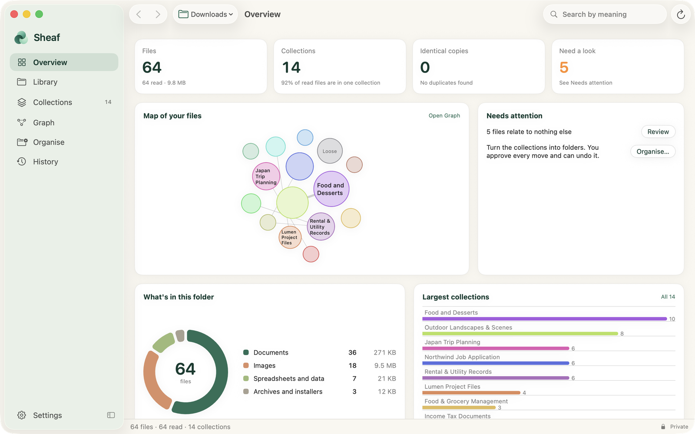
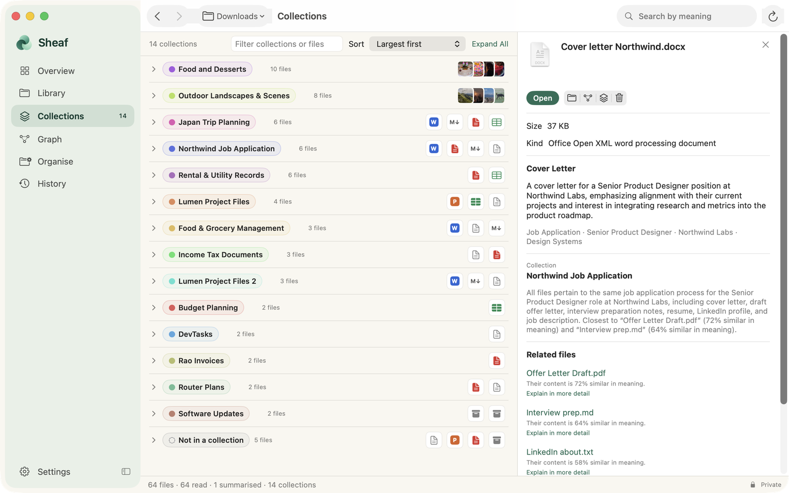
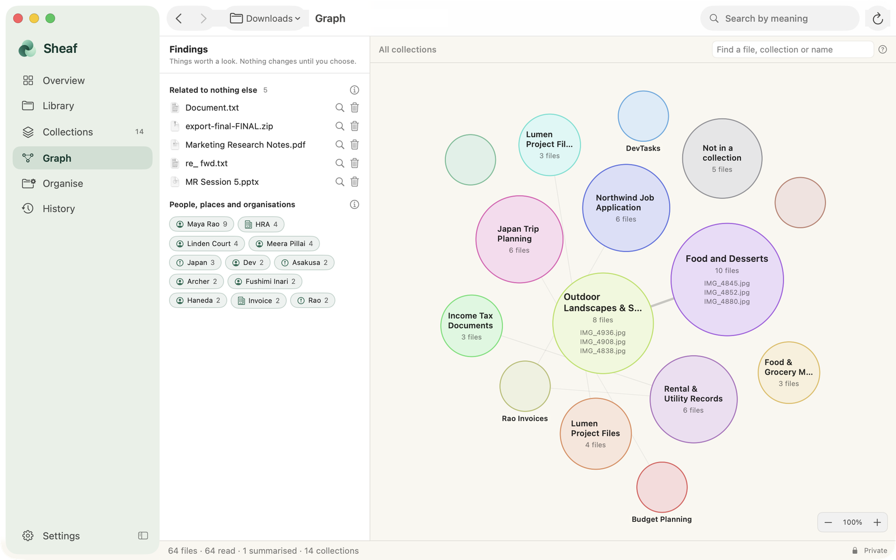
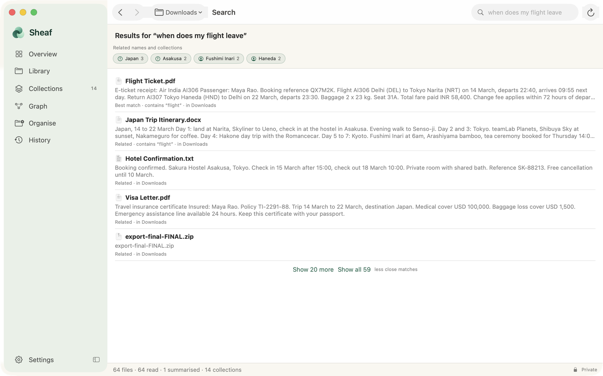
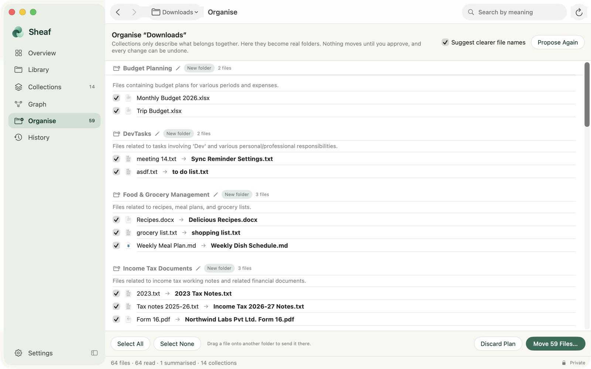

# Sheaf

  

**Understands your files, not just their names.** Sheaf is a free Mac app that reads a folder, works out what each file is about, finds the files that belong together, and proposes an organisation you approve. Everything runs on your Mac.

- **Local only.** No account, no cloud, no telemetry. The only network connection is to the model server on your own Mac.
- **Never moves anything without your approval.** Every change is journaled and can be undone.
- **Explains itself.** Every relationship, collection and proposed move comes with the reason.
- **Free.** No subscription, no ads.

| Collections | Graph |
|---|---|
|  |  |
| **Search by meaning** | **Organise** |
|  |  |

## Install

Requires Apple Silicon and macOS 14 or later, plus [Ollama](https://ollama.com) for the local models (about 2.5 GB, one time).

1. Download the DMG and its `.sha256` file from [Releases](../../releases/latest). Check it: `shasum -a 256 -c Sheaf-<version>-arm64.dmg.sha256`
2. Drag Sheaf to Applications.
3. The app is **not signed or notarised yet**, so macOS blocks the first launch. Open System Settings > Privacy & Security and choose **Open Anyway**. Details in [docs/INSTALL.md](docs/INSTALL.md).
4. Install [Ollama](https://ollama.com/download) (or `brew install ollama`). When you open Sheaf, setup finds it, starts it if needed and downloads both models (about 2 GB, once) with one click.

## Privacy

Your files and their contents never leave your Mac. See [PRIVACY.md](PRIVACY.md) for what Sheaf does on the network, and [how to verify it yourself](docs/VERIFY-PRIVACY.md).

## Documentation

- [Installing Sheaf](docs/INSTALL.md)
- [FAQ](docs/FAQ.md)
- [Troubleshooting](docs/TROUBLESHOOTING.md)
- [Models](docs/MODELS.md)
- [Roadmap](ROADMAP.md) and [Changelog](CHANGELOG.md)

## Source code

This repository holds releases, documentation and the issue tracker. The source is private for now. **When this repository reaches 100 stars, the source code goes public** so the community can build on it. A star is how you vote for that.

## Beta feedback

Sheaf is in public beta. Bugs, wrong groupings and ideas are very welcome: [open an issue](../../issues/new/choose). Describe files rather than attaching them. See [CONTRIBUTING.md](CONTRIBUTING.md) for ways to help and [SECURITY.md](SECURITY.md) for reporting vulnerabilities privately.

Licence: [free to use](LICENSE.txt).
